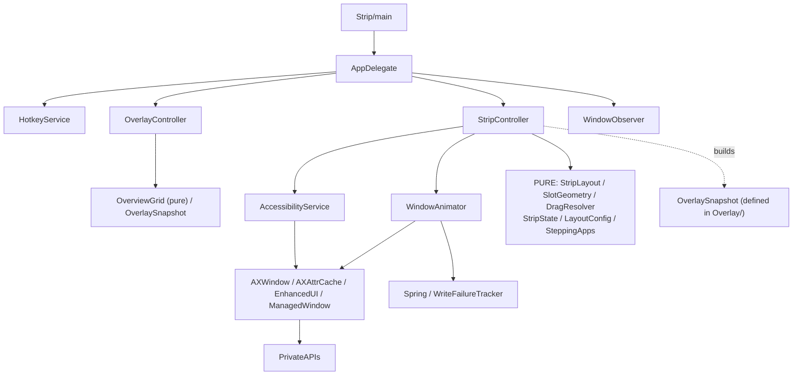

# Architecture

**Strip** is a macOS window manager that arranges third-party application windows into a horizontal "film strip": one window is centered and focused, its neighbors flow past it through a fixed set of on-screen slots, and windows outside the visible slots are parked off-screen. It is built with Swift and AppKit and moves and resizes live windows exclusively through the macOS Accessibility (AX) API — without disabling System Integrity Protection, without a scripting addition, and without private window-moving calls.

This document is the canonical description of the system as built. File references use paths relative to the repository root and name the specific types and functions involved.

---

## Purpose

Strip's job is to tile real windows belonging to other applications into a single horizontal strip and keep one window centered and focused while the rest flow through fixed slots. It runs as a background accessory app (`LSUIElement`, `NSApplication.ActivationPolicy.accessory`) — no Dock icon and no main window — so it never takes focus from the windows it manages. Its only on-screen controls are a menu bar status item and floating overlay panels; the menu bar is one of its surfaces, not its defining trait.

All window movement is performed through the Accessibility API, reading and writing each window's `kAXPosition` and `kAXSize`. Window identity is obtained from one private read-only symbol, `_AXUIElementGetWindow`, which yields a stable `CGWindowID`; that identifier is used only for identity, never to move windows.

The layout mathematics originated in HTML/JS `geom()` / `resolve()` / `computeVM()` concepts. The original export is not distributed; the durable implementation is the Swift layout engine and its tests. Window motion is animated with per-window springs driven by a display-link loop.

---

## System Overview

The system is organized as a pure layout core surrounded by a macOS integration layer. Three input paths — a global hotkey event tap, a status-bar menu, and an automatic reconciler fed by AX/Workspace notifications — converge on a single coordinator, `StripController`. The coordinator mutates logical state, recomputes the layout, and hands target frames to an animator that writes them to real windows.

```mermaid
flowchart TD
    HK["HotkeyService<br/>(⌃⌥ CGEvent tap)"] -->|HotkeyCommand| AD
    MENU["Status-bar NSMenu"] -->|@objc actions| AD
    OBS["WindowObserver<br/>(AXObserver + NSWorkspace)"] -->|onReconcile / onFocusActivation / onUserDrag| SC
    AD["AppDelegate<br/>(lifecycle + wiring hub)"] --> SC

    SC["StripController<br/>(coordinator, owns StripState + windowsById)"]
    SC -->|build| SL["StripLayout (pure)<br/>resolve() + placements(in:)"]
    SL -->|"[WindowPlacement] (Quartz frames)"| SC
    SC -->|targets| AN["WindowAnimator<br/>(CADisplayLink springs)"]
    AN -->|off-main per-pid queue| AX["AXWindow.setFrame<br/>kAXPosition / kAXSize"]
    AX --> WS["Real app windows"]

    SC -->|enumerate| ACC["AccessibilityService<br/>allWindows() (main-bound)"]
    ACC --> WS
    SC -->|onRender OverlaySnapshot| OV["OverlayController<br/>(NSPanel + SwiftUI chrome)"]
    SC -->|onFocusFrame| OV
    OV -->|onCenter / onOverviewVisibility| SC

    subgraph PURE["Pure core (CoreGraphics only, unit-tested)"]
        SL
        STATE["StripState / SlotGeometry / DragResolver / LayoutConfig"]
    end
    SC -.uses.-> STATE
```

Defining characteristics:

- **Single coordinator.** `StripController` (`Sources/StripKit/StripController.swift`) owns the strip's logical state and is the only orchestrator of window layout. Layout-affecting commands, reconciles, and drags converge on its `apply()`; chrome-only commands (help, overview) are routed by `AppDelegate` straight to `OverlayController` and do not reach the controller.
- **Closure-based wiring.** The top-level collaborators are connected through closures (`onCommand`, `onReconcile`, `onRender`, `onFocusFrame`, `onCenter`, and others) assigned once in `AppDelegate.start()`, so they do not hold references to one another. (The controller does construct its own `AccessibilityService` and `WindowAnimator` directly — see [Limitations and Constraints](#limitations-and-constraints).)
- **Quartz coordinates internally.** All geometry is Quartz-global (top-left origin, Y increasing downward — the coordinate system the AX API itself uses). Conversion to Cocoa coordinates happens only at the AppKit boundary, in `Sources/StripKit/Layout/Coordinates.swift`.
- **`CGWindowID` as identity.** Windows are tracked by `CGWindowID` throughout (`StripState.ring`, `StripController.windowsById`, `StripState.pins`).

---

## Repository Structure

| Path | Responsibility | Notes |
|---|---|---|
| `Package.swift` | SwiftPM manifest | `swift-tools-version:6.0`, language mode v5 on every target, platform `macOS .v14`. No third-party dependencies. |
| `Sources/Strip/main.swift` | Process bootstrap | Sets `.accessory` activation policy, constructs `AppDelegate`, calls `app.run()`. |
| `Sources/StripKit/` | The `StripKit` library target — all application logic | Importable and unit-testable without booting AppKit. |
| `Sources/StripKit/AppDelegate.swift` | App lifecycle, Accessibility permission flow, status menu, the closure-wiring hub (`start()`), command routing | `handle(_:repeated:)` routes hotkey/menu commands to the controller or overlay. |
| `Sources/StripKit/StripController.swift` | The coordinator (701 lines) | Owns `StripState` and `windowsById`; performs reconciliation, the apply pipeline, focus routing, drag policy, suspend/release, and persistence. |
| `Sources/StripKit/Logging.swift`, `Signpost.swift` | File-mirrored logging and `os_signpost` instrumentation | `Log` is an enum namespace with a private serial queue; it writes to `/tmp/strip.log` because `open`-launched agents have no stdout. |
| `Sources/StripKit/Accessibility/` | macOS AX integration | `AccessibilityService` (enumeration), `AXWindow` (single-window read/write), `AXAttrCache` (attribute memo), `EnhancedUI`, `PrivateAPIs`, `WindowObserver`. |
| `Sources/StripKit/Animation/` | Animated window motion | `WindowAnimator` (display-link springs, off-main AX writes), `Spring` (`RectSpring` and presets), `WriteFailureTracker` (dead-element policy). |
| `Sources/StripKit/Input/HotkeyService.swift` | Global ⌃⌥ hotkeys via a CGEvent tap | Emits `HotkeyCommand`; provides a modal `OverviewKey` path while the overview is open. |
| `Sources/StripKit/Layout/` | Pure geometry and topology | `StripLayout` (ring rotation and placements), `SlotGeometry` (slot rectangles), `DragResolver` (inverse of `SlotGeometry`), `Coordinates` (Quartz↔Cocoa conversion). |
| `Sources/StripKit/Model/` | State, configuration, persistence | `StripState`, `LayoutConfig`, `ManagedWindow`, `Settings`, `SteppingApps`, `Theme`. |
| `Sources/StripKit/Overlay/` | On-top chrome: AppKit `NSPanel` hosting SwiftUI | Film rail, status pill, help overlay, overview grid, focus ring, thumbnails. |
| `Tests/StripKitTests/` | 12 XCTest files | Cover the pure types and extracted static functions; `@testable import StripKit`. |
| `Makefile`, `scripts/setup-signing.sh` | Build, run, signing | `make open` is the Accessibility-trusted launch path. |
| `.github/workflows/ci.yml` | CI | `macos-15` job running tests plus release-bundle metadata and signature validation. |
| `Resources/Info.plist` | Bundle configuration | `LSUIElement=true`, `LSMinimumSystemVersion 14.0`. |

---

## Runtime Architecture

**App launch** (`Sources/Strip/main.swift`, `AppDelegate.swift`):

1. `main.swift` obtains `NSApplication.shared`, sets `setActivationPolicy(.accessory)`, constructs `AppDelegate`, and calls `app.run()`.
2. `AppDelegate` constructs four collaborators as stored properties — `controller = StripController()`, `hotkeys = HotkeyService()`, `overlay = OverlayController()`, `observer = WindowObserver()` — plus a lazily built `NSStatusItem`.

**Permission checks** (`applicationDidFinishLaunching`):

3. `setUpStatusItem()` builds the "▦ Strip" status item and menu.
4. `AccessibilityService.ensureTrusted(prompt:)` runs. If already trusted, it calls `start()`. Otherwise `presentPermissionNotice()` shows an `NSAlert` deep-linking to System Settings → Privacy & Security → Accessibility, and `pollForTrust()` installs a 1-second repeating `Timer` that calls `start()` once `AccessibilityService.isTrusted` becomes true.
5. Accessibility is the only permission requested at launch. Screen Recording — a separate TCC grant — is requested the first time the overview opens (`OverlayController.loadThumbnails` → `WindowThumbnailer`).

**Wiring** (`AppDelegate.start()`): assigns all cross-component closures (for example `overlay.onCenter → controller.setCenter`, `controller.onRender → overlay.update`, `controller.onFocusFrame → overlay.updateFocusRing`, `hotkeys.onCommand → self.handle`, `observer.onReconcile → controller.refreshAndApply`, `observer.onUserDrag → controller.handleUserDrag`), then starts the hotkey tap and the window observer and performs the first `controller.refreshAndApply()`.

**Window discovery** (`AccessibilityService.allWindows()`): iterates `NSWorkspace.shared.runningApplications` (regular, non-terminated), reads `kAXWindowsAttribute` per application, and classifies each element through `classifyGates`: role is window, not minimized, frame at least 80×80, subrole is standard or absent, and the window is resizable, yielding a `.managed` verdict. Identity comes from `_AXUIElementGetWindow` (`PrivateAPIs.swift`). A window's `frame` and `isMinimized` are read live on each scan and are never cached, because windows on other Spaces return stale or zero geometry through AX.

**Screen discovery**: `StripController.activeScreen()` selects the `NSScreen` under the mouse (falling back to `NSScreen.main`, then the first screen) and re-selects it on each `refresh()`. The strip is a single global ring projected onto whichever screen is currently active.

**Hotkey registration** (`HotkeyService.start()`): creates a keyDown `CGEvent.tapCreate(.cgSessionEventTap, .headInsertEventTap, .defaultTap)` and adds its source to `CFRunLoopGetMain()` in `.commonModes` (`HotkeyService.swift:71`). The tap recognizes the ⌃⌥ chord, rejects any combination that includes ⌘ (so application shortcuts are not shadowed), consumes matched events by returning `nil`, and dispatches the resulting `HotkeyCommand` to the main queue.

**Command execution**: `AppDelegate.handle(_:repeated:)` special-cases `.releaseAll`, calls `controller.resumeIfSuspended()` for non-overlay commands, then dispatches to a controller method (`rotate`, `focusMove`, `moveWindow`, `setCols`, `togglePin`, `adjustFocusRatio` / `adjustHeight` / `adjustGap`, `cycleSpring`) or an overlay method (`toggleHelp`, `toggleOverview`, `navigateOverview`).

**Layout application** (`StripController.apply()`): the single execution path (see the sequence diagram below). Each `apply()` recomputes all placements from scratch.

**Change handling** (auto-react): `WindowObserver` debounces bursts of AX and Workspace notifications and selects either a `.full` reconcile (`onReconcile → refreshAndApply()`) or a `.lightweight(pid)` focus event (`onFocusActivation → handleExternalActivation`, which skips re-enumeration when the focused window is already managed). User drags flow through `onUserDrag → handleUserDrag`.

### Sequence: hotkey → layout → AX write

```mermaid
sequenceDiagram
    participant WS as WindowServer
    participant Tap as CGEventTap cb (main runloop)
    participant Main as Main queue
    participant AD as AppDelegate.handle
    participant SC as StripController
    participant SL as StripLayout (pure)
    participant AN as WindowAnimator
    participant DL as CADisplayLink (main)
    participant Q as per-pid serial queue
    participant AX as AXWindow.setFrame

    WS->>Tap: keyDown ⌃⌥L
    Note over Tap: command(for:) matches chord<br/>emit chordLatency signpost
    Tap->>Main: DispatchQueue.main.async(onCommand)
    Tap-->>WS: return nil (consume)
    Main->>AD: handle(.slideNext, repeated)
    AD->>SC: rotate(1, repeated)
    Note over SC: navStep — fresh: now;<br/>held: paced to minNavInterval 0.20s
    SC->>SC: advanceCenter (mutates state.centerId)
    SC->>SC: scheduleApply() (coalesce → main.async)
    Main->>SC: apply()
    SC->>SL: placements(in: screen.quartzVisibleFrame)
    SL-->>SC: [WindowPlacement] (signpost placements)
    SC->>AN: animate(targets, on: screen)
    AN->>DL: ensureRunning (unpause link)
    loop every refresh tick (main)
        DL->>AN: tick(dt)  [dt clamped 1/240..1/30]
        Note over AN: spring.step per window; skip settled
        AN->>Q: queue(pid).async { setFrame } (guard !inFlight)
        Q->>AX: setFrame (off-main; size-pos-size idiom)
        AX-->>Q: AXError
        Q->>Main: main.async { inFlight.remove;<br/>WriteFailureTracker.record → maybe onWindowLost }
    end
    Note over SC: focus change only →<br/>scheduleFocus (debounce 0.17s,<br/>focusAttributes off-main, activateApp on main)
    SC->>SC: onRender(railSnapshot(layout)) → overlay
```

---

## Core Components

### App entry and lifecycle — `AppDelegate`

- **Responsibility:** process bootstrap, the Accessibility permission flow, the status-bar menu, the closure-wiring hub, command routing, and quit-time cleanup.
- **Key files/types:** `Sources/Strip/main.swift`; `Sources/StripKit/AppDelegate.swift` — `applicationDidFinishLaunching`, `start()`, `handle(_:repeated:)`, `setUpStatusItem` / `rebuildMenu`, `presentPermissionNotice`, `pollForTrust`, `applicationWillTerminate`.
- **Inputs:** `HotkeyCommand` from `HotkeyService`, `@objc` menu actions, AppKit lifecycle callbacks.
- **Outputs:** calls into the controller and overlay; assigns every cross-component closure.
- **Owned state:** the four collaborators, the `NSStatusItem`, and the trust-polling `Timer`.
- **Dependencies:** the controller, hotkey service, overlay controller, window observer, and `AccessibilityService.ensureTrusted` (static).
- **Notes:** `handle` performs routing only; no layout policy lives here. `applicationWillTerminate` calls `observer.stop()` followed by `controller.unparkAllOnScreen()`, so no managed window is left parked off-screen at quit.

### macOS platform integration — `Accessibility/`, `EnhancedUI`, `PrivateAPIs`

- **Responsibility:** all interaction with the Accessibility, Workspace, and SkyLight APIs.
- **Key files/types:** `AccessibilityService` (`isTrusted`, `ensureTrusted`, `allWindows`, `classifyGates`), `AXWindow` (`frame`, `isAlive`, `isResizable`, `setFrame`, `focus` / `focusAttributes` / `activateApp`), `EnhancedUI` (toggles `AXEnhancedUserInterface`), `PrivateAPIs` (`_AXUIElementGetWindow`, SkyLight blur), `AXAttrCache`.
- **Inputs:** running applications and AX elements.
- **Outputs:** `[ManagedWindow]`, classification verdicts, `CGWindowID` identity.
- **Owned state:** three `AXAttrCache` memos (role, subrole, resizable), pruned each scan via `retain(seen)`.
- **Notes:** window enumeration runs on the main thread; per-element reads and writes run off-main. `AXAttrCache` is documented as confined to the enumeration queue (`AXAttrCache.swift:12`).

### Window observation and control — `WindowObserver`, `WindowAnimator`

- **Responsibility:** observe real-window lifecycle and geometry; move and resize real windows.
- **Key files/types:** `WindowObserver` (per-application `AXObserver` plus `NSWorkspace` notifications plus a mouse-button monitor; statics `reconcileKind`, `batchAction`, `isSelfInducedActivation`). `WindowAnimator` (`animate`, `tick`, `write`, `queue(for:)`, `focusAttributes`, `snap`, `forget` / `reset`).
- **Inputs:** AX and Workspace notifications; layout targets of the form `(ax, frame, current)`.
- **Outputs:** `onReconcile` / `onFocusActivation` / `onUserDrag` callbacks; `kAXPosition` / `kAXSize` writes; `onFocusFrame` / `onWindowLost`.
- **Owned state (animator):** per-window `RectSpring`, an `inFlight` set for backpressure, `entries` / `lastWritten` / `drivenUntil` / `failures`, and `focusedID` — all touched on the main thread.
- **Notes:** writes run off-main on a per-pid serial queue (`io.github.shidil.strip.ax.<pid>`); completions hop back to the main thread. A write is dropped when one to the same window is already in flight (`inFlightDrop` signpost). `WriteFailureTracker` decides when a window element is dead: `.invalidUIElement` is immediately fatal; soft failures such as `.cannotComplete` must repeat a threshold of 3 times; any success resets the count.

### Screen and display model

- **Responsibility:** select the active display.
- **Key files/types:** `StripController.activeScreen()`; `Layout/Coordinates.swift` (`primaryHeight`, `NSScreen.quartzFrame` / `quartzVisibleFrame`).
- **Notes:** there is one global ring projected onto the mouse-active screen. The active screen is re-selected only in `init`, `refresh()` (`StripController.swift:136`), and the release path (`:580`); `apply()` reuses the stored `screen`. The application does not register for `NSApplication.didChangeScreenParameters`, so a display-configuration change takes effect on the next `refresh()` (the next reconcile), not on a plain `apply()`.

### Layout engine — `Layout/`

- **Responsibility:** decide which window occupies which slot (topology) and where each slot is positioned (geometry).
- **Key files/types:** `StripLayout.resolve()` (pin-aware ring rotation), `placements(in:)` (projection onto Quartz rectangles and parking of off-strip windows), `activeId`; `SlotGeometry.rects(...)`; `DragResolver.resizeConfig(...)`; the `WindowPlacement` struct.
- **Inputs:** `StripState` and a visible-frame `CGRect`.
- **Outputs:** `[WindowPlacement]` (Quartz frames) and slot assignments.
- **Owned state:** none; the computation is pure and its results are discarded after each `apply()`.
- **Notes:** `StripLayout`, `SlotGeometry`, and `DragResolver` are pure (CoreGraphics only, no AppKit or AX) and are covered by unit tests. `Coordinates.swift` also lives in `Layout/` but imports AppKit (`NSScreen`) — it is the Quartz↔Cocoa boundary, not part of the pure engine. See [Layout Architecture](#layout-architecture).

### Command and action dispatch — `StripController`

- **Responsibility:** the coordinator. Owns logical state, reconciles enumeration results, runs the apply pipeline, routes focus, applies drag policy, manages suspend/release and persistence, and builds overlay snapshots.
- **Key files/types:** `StripController.swift` — `apply()`, `scheduleApply()`, `navStep`, `scheduleFocus`, `refresh()`, `handleExternalActivation`, `handleUserDrag`, `dropLostWindow`, `unparkStranded` / `unparkAllOnScreen` / `releaseAll` / `resume`, `railSnapshot`, `restoreSettings` / `persist`.
- **Inputs:** commands from `AppDelegate`, reconcile and drag callbacks from `WindowObserver`, `onWindowLost` from the animator.
- **Outputs:** animator targets, `onRender` / `onFocusFrame`, persisted settings.
- **Owned state:** `state: StripState` (`public private(set)`), `windowsById: [CGWindowID: ManagedWindow]`, `screen`, `lastFocusedId`, `springIndex`, `isSuspended`, `focusRingEnabled`.
- **Dependencies:** `private let ax = AccessibilityService()` and `private let animator = WindowAnimator()`, constructed inline (`StripController.swift:7-8`).
- **Notes:** `state.ring` is the authority for membership; `windowsById` is rebuilt to match `state.ring` on each `refresh()`. The animator holds a separate physical position (`spring.current`) that is treated as an invalidatable cache (`forget` / `reset`).

### Hotkey handling — `HotkeyService`

- **Responsibility:** recognize the ⌃⌥ chord and the overview modal keys, and emit commands.
- **Key files/types:** `HotkeyService.swift` — `start()`, `command(for:)`, `overviewKey(for:)`, `hotkeyTapCallback`, `reEnable()`; the `HotkeyCommand` and `OverviewKey` enums; `kVK_*` constants declared at the bottom of the file.
- **Inputs:** raw `CGEvent` keydowns.
- **Outputs:** `onCommand(HotkeyCommand, repeated)` on the main thread.
- **Owned state:** the tap and its run-loop source; an `overviewOpen` flag.
- **Notes:** the tap source is installed on the main run loop. `tapDisabledByTimeout` and `tapDisabledByUserInput` are handled by `reEnable()` and a `tapDisabled` signpost. `start()` returns a `Bool`; `AppDelegate` does not act on a tap-creation failure beyond logging.

### State store — `Model/StripState`, `windowsById`

- **Responsibility:** the logical strip and the identity-to-handle map.
- **Key files/types:** `StripState` (`ring`, `centerId`, `cols`, `emphasis`, `pins`, `focusSlot`, `config`; mutations `togglePin`, `setCenter`, `insertManaged`, `clampToValidSlots`; the `posMod` helper). `ManagedWindow` (id plus `AXWindow` plus last-known frame/title plus theming).
- **Owned by:** `StripController`.
- **Notes:** `StripState` is pure (CoreGraphics only). `ManagedWindow` imports AppKit and holds a live `AXWindow` and an `NSColor`. The pure layout engine operates on `CGWindowID`s and never touches `ManagedWindow`.

### Settings and configuration — `LayoutConfig`, `PersistedSettings`

- **Responsibility:** sizing parameters and persisted layout posture.
- **Key files/types:** `LayoutConfig` (`outerPadding`, `innerGap`, `focusRatio` (default 0.5), `monocleWidthFraction`, `heightFraction`, `newWindowPlacement`; clamp ranges and a tolerant `init(from:)`). `PersistedSettings` (`config`, `cols`, `emphasisEqual`, `springIndex`, `focusRingEnabled`).
- **Notes:** clamping is applied at use (`clampedFocusRatio` and similar). `outerPadding` and `innerGap` have no clamp range; `adjustGap` floors them at 0. `newWindowPlacement` is persisted and defaulted but has no menu or hotkey affordance. See [Configuration and Persistence](#configuration-and-persistence).

### UI surfaces — `Overlay/`, status menu

- **Responsibility:** all user-facing chrome.
- **Key files/types:** `OverlayController` (`makePanel`, `update` / `renderNow`, `updateFocusRing`, `toggleHelp` / `toggleOverview`, `loadThumbnails`); SwiftUI views `FilmRailView`, `StatusPillView`, `HelpOverlayView`, `OverviewView`; the pure `OverviewGrid.nextOverviewIndex`; `OverlaySnapshot` / `OverlayModel`; `ThumbnailStore` / `WindowThumbnailer`. The status menu is built in `AppDelegate.rebuildMenu`.
- **Notes:** there is no preferences window; configuration is changed through menu items and hotkeys. See [UI Architecture](#ui-architecture).

### Persistence — `Settings.swift`

- **Responsibility:** the single `UserDefaults` blob.
- **Key files/types:** `PersistedSettings.load` / `save` (key `strip.settings.v1`, JSON); `StripController.restoreSettings` / `persist`.
- **Notes:** `UserDefaults` is referenced only in `Settings.swift`. `StripController` reads it once in `init` (`restoreSettings()`) and writes through `persist()`. See [Configuration and Persistence](#configuration-and-persistence).

### Logging and instrumentation — `Logging`, `Signpost`

- **Responsibility:** file-mirrored logging and `os_signpost` intervals on the hot path.
- **Key files/types:** `Log` (an enum namespace with a private serial queue `io.github.shidil.strip.log`, writing `/tmp/strip.log`); `Signpost` (subsystem `io.github.shidil.strip`, category `hotpath`; intervals such as `placements`, `allWindows`, `chordLatency`; events such as `inFlightDrop`, `tapDisabled`, `reconcile.skip`).
- **Notes:** `Log` is reachable from every layer and is serialized through its own queue. Signposts carry no cost when not recording; `make profile` attaches `xctrace`.

---

## Domain Model

| Concept | Meaning in this codebase | Key types/files |
|---|---|---|
| **Strip / film** | The horizontal sequence of managed windows | `StripState.ring` |
| **Slot** | A fixed on-screen position (`L`, `C`, `R`) that windows flow through | `StripState.Slot`, `SlotGeometry` |
| **Center** | The window pulled to the anchor slot | `StripState.centerId` |
| **Ring** | The ordered list of managed window ids; wraps via `posMod` | `StripState.ring`, `StripState.posMod` |
| **Pin** | A window locked to a specific slot, exempt from rotation | `StripState.pins`, `togglePin` |
| **Parked** | A window pushed fully off the nearest screen edge | `StripLayout.parkedFrame`, `WindowPlacement.parked` |
| **Emphasis** | Width policy: `.focus` (emphasized slot wider) or `.equal` | `StripState.Emphasis`, `SlotGeometry.rects` |
| **Monocle** | One-up: a single centered window with margins | `cols == 1`, `monocleWidthFraction` |
| **Cols** | The visible slot count (1, 2, or 3) | `StripState.cols` |
| **Managed / floating / ignored** | Classification verdicts for an enumerated window | `AccessibilityService.classifyGates` |
| **Sticky membership** | A managed window stays in the ring while its element is `isAlive`, even when parked or transiently unscanned | `StripController.refresh()` |
| **Transient-miss resilience** | A ring window absent from one scan but still alive is retained | `refresh()` |
| **Orphan reclaim** | A window centered on no display is re-absorbed | `belongsToActiveStrip` |
| **Dominant window** | The window occupying the emphasized slot (the target of a kept resize) | `StripController.dominantWindowId` |
| **Stepping app** | A terminal-class application that quantizes size to character cells; resized by snap rather than spring | `Model/SteppingApps` |
| **Snap vs spring** | Instant frame set vs display-link spring animation | `WindowAnimator.snap` vs `animate` |
| **Posture vs identity** | Persisted layout settings vs ephemeral window ids | `PersistedSettings` (posture); ring/center/pins (identity) |
| **Self-induced activation** | A focus/activation event caused by Strip's own `focus()`, which is suppressed | `WindowObserver.isSelfInducedActivation` |
| **Driven-grace** | A 0.25 s window in which Strip's own moves are recognized so they are not mistaken for user drags | `WindowAnimator.isDriving`, `drivenUntil` |
| **In-flight drop / backpressure** | Skipping a frame write that overlaps the prior write to the same window | `WindowAnimator.write`, `inFlight` |

---

## Event and Data Flow

Three ingress paths converge on `StripController.apply()`:

```mermaid
flowchart LR
    subgraph IN["Inputs"]
        K["Hotkey (⌃⌥+key)"]
        M["Menu item"]
        O["AX/Workspace notifications"]
        D["kAXMoved/kAXResized + mouse"]
    end

    K -->|consume + main.async| H["AppDelegate.handle"]
    M -->|@objc| H
    H -->|controller method| MUT["mutate StripState"]
    MUT --> APPLY["apply() (coalesced via scheduleApply)"]

    O -->|debounce 0.075s| RK{reconcileKind}
    RK -->|.full| REF["refresh() → re-enumerate + reconcile ring"]
    RK -->|.lightweight pid| HEA["handleExternalActivation<br/>(skip enum if already managed)"]
    REF --> APPLY
    HEA -.skip.-> APPLY

    D -->|accumulate, flush on mouseUp| UD["handleUserDrag<br/>(snap-back OR keep-resize via DragResolver)"]
    UD --> APPLY

    APPLY --> SL["StripLayout.placements(in: vis)"]
    SL --> AN["WindowAnimator (springs / snap)"]
    AN --> AXW["AXWindow.setFrame"]
    APPLY --> RENDER["onRender(OverlaySnapshot) → OverlayController"]
    AN --> FR["onFocusFrame → focus ring panel"]
```

Data direction:

- **State to system:** `windowsById[id].frame` is the seed (`current`) for the animator, refreshed only on `refresh()` and `handleUserDrag`. It is not a live mirror; the animator owns live position.
- **System to state:** two paths write live geometry inward — `refresh()` (rebuilds frames from enumeration) and `handleUserDrag` (a kept dominant-window resize maps the new frame back into `state.config` through `DragResolver`).

---

## Concurrency and Threading Model

The codebase uses no locks and no actors. Thread safety rests on two conventions: all shared mutable state is confined to the main thread, and AX writes run on a per-pid serial queue with completions hopping back to the main thread. These conventions are maintained by construction rather than enforced by the type system.

**On the main thread (all event-facing work):**

- All `kAXWindows` enumeration (`AccessibilityService.allWindows`, `WindowObserver.watchAllWindows`, `focusedWindowID`). Enumeration off the main thread returns degraded data.
- All `AXObserver` callbacks, the CGEvent tap source, the `CADisplayLink` tick, the trust `Timer`, and the `NSEvent` mouse monitor.
- All `StripController` / `StripState` / `StripLayout` mutation, and all `WindowObserver` bookkeeping.
- All `NSPanel` / `NSHostingView` / SwiftUI mutation (`OverlayController` guards with `onMain`).
- `NSRunningApplication.activate()` (running it off-main produced roughly 400 ms stalls; see `AXWindow.activateApp`).
- `WriteFailureTracker.record` (hopped back to the main thread).
- Animator state: `inFlight`, `entries`, `lastWritten`, `drivenUntil`, `failures`, `focusedID`.

**Off the main thread (per-pid serial `DispatchQueue`, `io.github.shidil.strip.ax.<pid>`):**

- The animator's display-link tick writes (`AXWindow.setFrame`), `EnhancedUI` toggles, and `focusAttributes` (the AX half of focus). FIFO ordering guarantees that disabling `AXEnhancedUserInterface` precedes frame writes and that re-enabling it (in `stop()`) follows the final frame.

Not every AX frame write uses this queue. `WindowAnimator.snap` (the un-animated path, taken when `animated == false`) and the release/quit unpark writes (`StripController.unparkStranded` / `unparkFrame`) call `setFrame` synchronously on the calling thread, which is the main thread. Only the tick path runs off-main with backpressure. See [Limitations and Constraints](#limitations-and-constraints).

**Focus split:** `scheduleFocus` runs the AX half (`animator.focusAttributes`, which sets `kAXMain` / `kAXFocused` and performs `kAXRaise`) off-main, and the AppKit half (`activateApp`) on the main thread.

`Log` is thread-safe through its own serial queue. `AXAttrCache` is documented as confined to the main-bound enumeration path.

---

## macOS Platform Integration

**Frameworks (all from the Apple SDK; no third-party dependencies):** Accessibility / `ApplicationServices` (the AX API), `AppKit` (app lifecycle, menu, panels, `NSScreen`), `CoreGraphics` / Quartz event taps (hotkeys, Screen-Recording preflight), `QuartzCore` (`CADisplayLink` via `NSScreen.displayLink`, `CACurrentMediaTime`), `ScreenCaptureKit` (overview thumbnails), `SwiftUI` (overlay content), and `os` (signposts).

**Permissions (two TCC grants):**

- **Accessibility** — owned by `AccessibilityService`, prompted at launch and polled until granted. Required for all window control.
- **Screen Recording** — owned by `WindowThumbnailer`, requested the first time the overview opens. Until granted, overview cards show accent-gradient placeholders.

**Private and undocumented APIs (isolated in `Accessibility/PrivateAPIs.swift`, bound with `@_silgen_name`):**

- `_AXUIElementGetWindow`, which returns a `CGWindowID` used only for identity. This is the standard no-SIP identity symbol. Because `@_silgen_name` binds by name with no compile-time signature check, an OS ABI change would surface at runtime rather than at build time, and a nil result makes the window unmanageable.
- `CGSMainConnectionID` and `CGSSetWindowBackgroundBlurRadius` (SkyLight), used for the behind-window blur of the overview backdrop. Errors are ignored.

**Platform behaviors the code accounts for:**

1. `kAXWindows` enumeration runs only on the main thread; the cost is managed by frequency (`handleExternalActivation` skips enumeration on pure focus changes) rather than by threading.
2. SwiftUI and AppKit rendering run only on the main thread; the code keeps rendering incremental rather than relocating it.
3. `AXEnhancedUserInterface` interferes with AX-driven moves and is disabled per application for the duration of motion (`EnhancedUI`).
4. Terminal applications quantize size to character cells (`SteppingApps`) and are resized by snap rather than spring when re-absorbed.
5. `NSRunningApplication.activate()` runs on the main thread (off-main caused roughly 400 ms stalls).
6. The event tap runs on the main run loop and is automatically re-enabled when the system disables it on timeout or user input.

**Window-write idiom:** `AXWindow.setFrame` sets size, then position, then size again, to defeat constraint clamping. The initial resize is skipped for pure-move frames (`skipInitialResize`).

---

## Layout Architecture

The layout engine is a pure, value-typed core — `StripLayout`, `SlotGeometry`, and `DragResolver` in `Sources/StripKit/Layout/` (the directory also holds `Coordinates.swift`, which is the AppKit boundary, not part of the engine). It has two independent halves:

- **Topology** (`StripLayout.resolve()`): decides which window lands in which slot by pin-aware ring rotation. Unpinned slots are filled by rotating the unpinned ring around the center — `assign[s] = unpinned[posMod(centerPos + (k - anchorIdx), m)]` (`StripLayout.swift:68`) — while pinned slots are taken directly from `pins`.
- **Geometry** (`SlotGeometry.rects(cols:emphasis:focusSlot:in:config:)`): decides where each slot sits — the width split (focus ratio or equal), the height fraction (vertically centered), padding, gaps, and monocle centering. It always emits Quartz rectangles.

`StripLayout.placements(in:)` joins the two: for every window in `state.ring` it computes a target frame, and windows whose slot index falls outside the visible slots are parked off the nearest edge (`parkedFrame`, with `parkGap = 40`). The two halves are independent — geometry never reads the ring, and topology never reads pixels.

**Coordinate invariant:** everything internal is Quartz-global (top-left origin, Y downward). Because AX is itself Quartz, placements feed directly into `AXWindow.setFrame` without conversion. Cocoa coordinates appear only at the AppKit boundary, through `Coordinates.swift` (`toQuartz` / `toCocoa`, pivoting on `primaryHeight`), and only for overlay panels.

**Recompute model:** each command mutates `StripState`, then `apply()` recomputes all placements from scratch; computation is not incremental. `placements(in:)` maps over the entire `state.ring` (`StripLayout.swift:90`) and `apply()` builds one animator target per placement, so layout and target construction scale with the number of managed windows. The number of *visible* slots is bounded by `cols` (default 3); off-strip windows still receive parked placements. The animator absorbs the result through in-flight drops and spring re-targeting, and bursts are coalesced into one `apply()` per run-loop pass (`scheduleApply`).

**Multi-monitor:** a single global ring is projected onto the active screen (`activeScreen()`). There are no per-display strips and no inter-display moves.

**Emphasized-slot rule:** the rule for which slot is emphasized is computed in three places that must agree — `SlotGeometry.rects` (`SlotGeometry.swift:39`, `rawEmphasis`), `StripController.dominantWindowId` (`StripController.swift:567`), and `DragResolver` (`n = cols == 2 ? 2 : 3`).

---

## Configuration and Persistence

There is no preferences UI; configuration is changed through menu items and hotkeys.

**Persistence boundary — posture, not identity:**

| Persisted (`strip.settings.v1`, JSON in `UserDefaults`) | In-memory, rediscovered each launch |
|---|---|
| `config` (`LayoutConfig`) | `ring` |
| `cols` | `centerId` |
| `emphasisEqual` (Bool) | `pins` |
| `springIndex` | `focusSlot` |
| `focusRingEnabled` | `windowsById`, `screen`, `lastFocusedId`, `isSuspended` |

Window identity is excluded because `CGWindowID`s are not stable across relaunch (documented in `Settings.swift`). Persistence is contained in `Settings.swift`; `UserDefaults` is referenced nowhere else. `StripController` touches it only through `restoreSettings()` (once, in `init`) and `persist()`.

**`persist()` call sites:** `setCols`, `setEmphasis`, `cycleSpring`, `adjustFocusRatio`, `adjustHeight`, `adjustGap`, `setFocusRing`, and the kept-resize branch of `handleUserDrag`. `rotate`, `moveWindow`, `togglePin`, and `setCenter` do not persist, consistent with the identity exclusion.

**Versioning:** there is no migration mechanism; the `v1` suffix is part of the key name. Forward compatibility comes from tolerant decoding (`decodeIfPresent ?? default` in both `PersistedSettings.init(from:)` and `LayoutConfig.init(from:)`), so adding a field does not invalidate an existing blob. Changing the key resets to defaults. Decode and encode failures fall back to defaults.

**Clamping:** applied at use (`clampedFocusRatio`, `clampedMonocleWidth`, `clampedHeight`). `outerPadding` and `innerGap` have no clamp range; `adjustGap` floors them at 0.

**Spring presets:** `SpringConfig.presets = [.track, .pop, .glide]`, cycled by the `t` key (`cycleSpring`), with the index persisted. A fourth preset, `.snapBack`, is used internally for drag snap-back and is not part of the cycle.

---

## UI Architecture

There are two kinds of surface, both shelled in AppKit:

1. **Status-bar menu (AppKit).** `AppDelegate.rebuildMenu()` builds a fresh `NSMenu` on each call; items target `@objc` actions that forward to the controller or overlay. The only stateful item is the checkable "Show focus ring." Menu key-equivalents are plain (active only while the menu is open) and are distinct from the global hotkeys.

2. **Overlay chrome (AppKit `NSPanel` hosting SwiftUI).** The panel is borderless and `.nonactivatingPanel`, with `.canJoinAllSpaces` / `.fullScreenAuxiliary` / `.stationary`. `OverlayController` manages five surfaces:

| Surface | Technology | Lifecycle |
|---|---|---|
| Film rail (bottom) | SwiftUI `FilmRailView` | Persistent; `rootView` set once, updated through a `@Published OverlayModel` |
| Status pill (top) | SwiftUI `StatusPillView` | Persistent; same model |
| Focus ring | Bare `NSView` with a CALayer border | Persistent; moved each animation tick through `onFocusFrame` |
| Help (⌃⌥/) | SwiftUI `HelpOverlayView` | Ephemeral; rebuilt on open |
| Overview (⌃⌥Space) | SwiftUI `OverviewView` | Ephemeral; the keyboard cursor lives in `OverviewSelection` (an `ObservableObject`) because the hosting view is rebuilt |

**State observation is push-based through immutable snapshots.** After each `apply()`, `StripController` emits `onRender(railSnapshot(layout))`, an `OverlaySnapshot` carrying rail items, the screen, and pill strings. `OverlayController.update` coalesces renders to roughly 60 fps (`minRenderInterval = 1/60`, leading and trailing edge) and mutates `OverlayModel` only on change (relying on the hand-written `Equatable` of `RailItem` / `StatusFields`). An open overview updates immediately, without throttling.

**Boundary:** the Overlay layer does not reference `StripController` or `StripState` (only doc-comment mentions). It reaches back through two callbacks — `onCenter` (chip or card tap → `setCenter`) and `onOverviewVisibility` (gates hotkeys). Coupling in both directions is callback-only.

**Overview thumbnails:** `WindowThumbnailer` (ScreenCaptureKit) populates `ThumbnailStore` (`@Published [CGWindowID: CGImage]`), keyed by `CGWindowID == SCWindow.windowID`. Behind-window blur is applied at the window-server level (SkyLight) rather than with `NSVisualEffectView`.

---

## Testing and Development Workflow

**Tests (`Tests/StripKitTests/`, 12 XCTest files, single target).** Each file maps to a pure type or an extracted static or free function: `StripLayoutTests`, `StripStateTests`, `DragResolverTests`, `AXAttrCacheTests` (synthetic keys, no real AX), `WindowObserverTests` (statics plus an injectable `now`), `WriteFailureTrackerTests`, `SettingsTests` (an isolated `UserDefaults(suiteName:)`, forward-compat decode), `OverviewGridTests`, `OverlayModelTests`, `SteppingAppsTests`, `StripControllerTests` (the static `unparkFrame`), and `ThemeTests`.

The tests cover the pure layer. The integration layer — `StripController` orchestration, the `WindowAnimator` loop, `AccessibilityService` / `AXWindow`, `HotkeyService`, `OverlayController`, the SwiftUI views, and `AppDelegate` wiring — is exercised by running the app rather than by automated tests, consistent with the extract-pure approach.

**Build (`Makefile`):**

- `make test` runs `swift test` (no permissions needed).
- `make bundle` builds, assembles `.build/Strip.app`, copies `Resources/Info.plist`, and codesigns with the stable "Strip Dev" identity (or ad-hoc if unavailable).
- `make open` launches the bundle through LaunchServices — the Accessibility-trusted launch path. The launched app has no stdout and logs to `/tmp/strip.log`.
- `make run` runs the inner binary directly as a build check; this path is not Accessibility-trusted (TCC attributes it to the parent shell).
- `make profile` launches the app and attaches `xctrace` (default `Logging` template for signposts).
- `make setup-signing` creates the one-time self-signed "Strip Dev" certificate. The signing identity must remain stable, or each rebuild invalidates the TCC grant.

**CI (`.github/workflows/ci.yml`):** a single job on `macos-15` running `swift test`. There is no lint or format gate, no perf gate, and no app build or signing step.

---

## Dependency Boundaries



- Dependencies run uniformly downward: `Strip → AppDelegate → {services} → {AX / Animation / pure core}`. There are no cycles, and the pure core imports nothing upward.
- There is no inter-collaborator type coupling. `AppDelegate.start()` is the single wiring point; coupling is through closures and shared value types.
- The pure layout engine (`StripLayout`, `SlotGeometry`, `DragResolver`, `StripState`, `LayoutConfig`) depends on CoreGraphics only.
- A few types under `Model/` and `Layout/` depend on AppKit: `ManagedWindow` (holds `AXWindow` and `NSColor`), `Theme` (returns `NSColor`), and `Coordinates` (uses `NSScreen` for the Quartz↔Cocoa conversion).
- `Spring` and `WriteFailureTracker` live under `Animation/` but are pure value types. `WriteFailureTracker` imports both `ApplicationServices` and `CoreGraphics` to interpret `AXError`.
- `OverlaySnapshot` (the controller-to-UI contract) is defined under `Overlay/` but built by `StripController.railSnapshot` and carries AppKit types (`NSScreen`, `NSColor?`) — a one-way downward type reference.

---

## Common Change Guide

| Change | Start here | Watch out for |
|---|---|---|
| **Add a layout / geometry variant** | `SlotGeometry.rects()`; add a knob to `LayoutConfig` (with a clamp range and a tolerant-decode entry); add a `StripLayoutTests` case | If it introduces a new emphasized-slot rule, mirror it in all three locations: `SlotGeometry.swift:39`, `StripController.dominantWindowId` (`:567`), and `DragResolver`. A genuinely new topology means branching `StripLayout.resolve()` / `placements()`. |
| **Add a column count / slot** | `StripState.slots` / `primarySlot` / `newWindowSlotPreference`, plus `SlotGeometry`'s slot switch | `resolve()` is generic over `slots`, so rotation adapts automatically. |
| **Change hotkey behavior** | `HotkeyService.command(for:)` keycode table, the `HotkeyCommand` enum, and the switch in `AppDelegate.handle(_:repeated:)` | The ⌃⌥ chord must not include ⌘. Overview modal keys are a separate path (`overviewKey(for:)`, gated by `overviewOpen`). |
| **Change window discovery** | `AccessibilityService.classifyGates` (what counts as managed) and `StripController.refresh()` plus `belongsToActiveStrip` (membership policy) | `refresh()` retains ring windows on `isAlive` alone and does not re-classify already-managed windows. `frame` and `isMinimized` must stay un-cached (off-Space staleness). |
| **Change window movement / resizing** | `WindowAnimator` (`animate` / `tick` / `write`) for animated motion; `Spring` / `SpringConfig` for feel | Three code paths write frames and must stay consistent: the animator's display-link loop (off-main on the per-pid queue, with backpressure), `WindowAnimator.snap` (synchronous, when `animated == false`, `WindowAnimator.swift:186`), and `StripController.unparkStranded` / `unparkFrame` (synchronous at release and quit, `StripController.swift:620`). Both `snap` and the release path call `setFrame` synchronously on the main thread; only the tick path goes off-main. |
| **Add a setting** | A `PersistedSettings` field plus a `LayoutConfig` entry (tolerant decode) plus a `persist()` call site in the mutating command plus `restoreSettings()` | There is no migration mechanism; rely on tolerant decode and do not change the `v1` key. Add a clamp range for sizing knobs. Expose the setting through the menu or a hotkey, or it will be reachable only by editing the blob (as with `newWindowPlacement`). |
| **Change UI** | `OverlayController` (panels and render), the relevant SwiftUI view, and `OverlaySnapshot` / `OverlayModel` for new data | The rail and pill are persistent (incremental `@Published` diff — keep `Equatable` correct); help and overview are rebuilt (no SwiftUI `@State` survives — use an `ObservableObject`). All panel and view mutation runs on the main thread. |
| **Add platform-specific handling** (fullscreen, Spaces, multi-display) | New code in `Accessibility/` and `StripController` reconcile; a screen-change observer would be installed in `WindowObserver.start` | These are not modeled today (see [Limitations and Constraints](#limitations-and-constraints)). Enumeration stays main-bound. |
| **Add tests** | Extract the decision into a pure `struct` / `enum` / `static` / free function, then add a `Tests/StripKitTests/` file | The concrete services on `StripController` (`private let ax` / `animator`) have no injection seam, so the orchestrator is not testable as written. Use the injectable parameters that exist (`now:`, `UserDefaults`). |

---

## Limitations and Constraints

These are factual properties of the current implementation to be aware of when changing it.

- **`StripController` concentrates the coordinator's responsibilities** in one 701-line type: state, persistence, reconciliation and discovery, the apply pipeline, focus routing, drag policy, suspend/release, and snapshot building. It is the highest-coupling node in the system. The responsibilities touch near-disjoint slices of its fields.
- **The integration layer has no injection seam.** `AccessibilityService` and `WindowAnimator` are constructed inline (`StripController.swift:7-8`), and there are no `protocol` declarations in `Sources/`. The orchestration logic therefore runs only against the real services and is not unit-testable in isolation.
- **Thread safety is convention-based.** There are no locks or actors; correctness depends on main-thread confinement and the per-pid write queue being respected by every caller. `AXAttrCache` documents (but does not assert) its single-queue confinement (`AXAttrCache.swift:12`).
- **Three code paths write window frames, with different threading.** The `WindowAnimator` display-link tick writes off-main on the per-pid serial queue with in-flight backpressure. `WindowAnimator.snap` (`WindowAnimator.swift:186`) and the release/quit writes in `StripController.unparkStranded` / `unparkFrame` (`StripController.swift:620`) both call `setFrame` synchronously on the main thread, without backpressure.
- **The event tap runs on the main run loop** (`HotkeyService.swift:71`). When the main thread is busy the system can disable the tap (`tapDisabledByTimeout` / `tapDisabledByUserInput`), which `reEnable()` recovers; a `tapDisabled` signpost records each occurrence.
- **The emphasized-slot rule is duplicated** across `SlotGeometry.swift:39`, `StripController.swift:567`, and `DragResolver`. The three must remain in agreement.
- **Some `Model/` and `Layout/` types depend on AppKit:** `ManagedWindow` and `Theme` hold `AXWindow` / `NSColor`, and `Coordinates` uses `NSScreen`. These types cannot be constructed in a headless context.

---

## Areas Not Yet Modeled

These behaviors are not represented in the code and would need explicit handling before relying on them.

- **Minimized-while-managed windows.** `refresh()` retains ring windows on `isAlive` alone (`StripController.refresh()`) and does not re-classify them; `kAXWindowMiniaturized` triggers a full reconcile, but the transient-miss path does not re-check minimized state. Whether a window minimized after joining the ring still receives frame writes is undetermined. Files to review: `StripController.refresh()`, `AccessibilityService.classifyGates`, `WindowObserver` notification routing.
- **Native fullscreen.** No `kAXFullScreen` attribute is read anywhere. A fullscreen window may be classified `.managed` and receive frame writes. Files to review: `AccessibilityService`, `StripController.apply`.
- **Multi-display, mid-session.** A single global ring is projected onto the mouse-active screen, with no per-display partition and no screen-change observer. Behavior when the mouse crosses displays during a session is not exercised by tests. Files to review: `activeScreen()`, `refresh()`, `Coordinates`.
- **Spaces.** There is no Spaces model; off-Space windows are handled only as a stale-geometry hazard during enumeration. Files to review: `AccessibilityService.allWindows`.

---

## Glossary

**Codebase terms** — see the [Domain Model](#domain-model) table for *strip/film, slot, center, ring, pin, parked, emphasis, monocle, cols, managed/floating/ignored, sticky membership, transient-miss resilience, orphan reclaim, dominant window, stepping app, snap vs spring, posture vs identity, self-induced activation, driven-grace, in-flight drop/backpressure.*

**macOS and platform terms:**

- **AX / Accessibility API** — the supported, no-SIP way to read and move other applications' windows.
- **TCC** — the macOS privacy and permission system. Strip uses two grants: Accessibility (window control) and Screen Recording (overview thumbnails).
- **`kAXWindows` / `AXUIElement` / `AXObserver`** — an application's collection of windows / a handle to one element / a per-application notification source.
- **`AXEnhancedUserInterface`** — an application-level AX flag that, when on, interferes with programmatic moves; Strip disables it during motion.
- **`_AXUIElementGetWindow` / `CGWindowID`** — the private symbol that yields a window's stable numeric id; used for identity only.
- **Quartz vs Cocoa coordinates** — Quartz has a top-left origin with Y downward (the AX system, and Strip's internal system); Cocoa has a bottom-left origin with Y upward (AppKit). Conversion happens only at the boundary (`Coordinates.swift`).
- **CGEvent tap** — a low-level keyboard hook used for global hotkeys.
- **`CADisplayLink`** — a callback synchronized to display refresh; it drives the spring animation loop.
- **SkyLight / CGS** — the private window-server framework; used here only for background blur.
- **`LSUIElement` / `.accessory` app** — a background application with no Dock icon and no presence in the ⌘-Tab switcher. It can still show a menu bar status item and windows.
- **`NSPanel` `.nonactivatingPanel`** — a floating window that shows chrome without taking keyboard focus.
- **Space** — a macOS virtual desktop (Mission Control). Strip has no Spaces model.
- **`@_silgen_name`** — a Swift attribute that binds a symbol by name with no compile-time signature check.
- **signpost / xctrace** — `os_signpost` instrumentation and the Instruments command-line tool used to record and analyze it.

---

## Agent Notes

For future AI coding agents and new engineers working in this repository.

**Read in this order:** `CLAUDE.md` (project rules, including the measure-first requirement and the documented platform dead-ends) → this document → `Sources/StripKit/StripController.swift` (the coordinator; read `apply`, `refresh`, `handleUserDrag`, `scheduleFocus`) → `Sources/StripKit/Layout/StripLayout.swift` and `SlotGeometry.swift` (the pure core) → `Sources/StripKit/Animation/WindowAnimator.swift` (the write path) → `Sources/StripKit/AppDelegate.swift` `start()` (the wiring).

**Boundaries to preserve:**

- Keep `Layout/` and the pure parts of `Model/` (`StripState`, `LayoutConfig`) free of AppKit and AX; place new decision logic there so it stays unit-testable.
- Keep internal geometry Quartz-global; convert to Cocoa only through `Coordinates.swift`.
- Keep inter-component communication closure-based and wired in `AppDelegate.start()`; do not add direct cross-collaborator type references.
- Keep animated AX writes off-main on the per-pid serial queue; the only synchronous exceptions are the documented release/quit writes in `unparkStranded` / `unparkFrame`.
- Keep persistence in `Settings.swift`; do not reference `UserDefaults` elsewhere.

**Invariants not to violate:**

- `kAXWindows` enumeration is main-thread-only; do not move it off-main, and do not enumerate on pure focus events (use the skip path in `handleExternalActivation`).
- SwiftUI and AppKit rendering are main-thread-only.
- `CGWindowID`s are not stable across relaunch; never persist them.
- The emphasized-slot rule has three copies that must stay in sync.
- Performance changes require a before/after trace per `MEASURING.md`; record the result in the `perf-review-2026-06` memory note.

**How to validate changes:**

- Pure logic: `make test` (keep it green; add a test for new pure decisions).
- Behavior on real windows: `make open` (the Accessibility-trusted launch), then `tail /tmp/strip.log`.
- Visual changes: verify with `screencapture` captured across a state change, not from metrics alone.
- Performance: `make profile` (attaches `xctrace`); read p50 / p90 / max of the relevant signpost interval and A/B with `git stash`.
- `make run` is not Accessibility-trusted; do not use it to validate permission-gated behavior.
