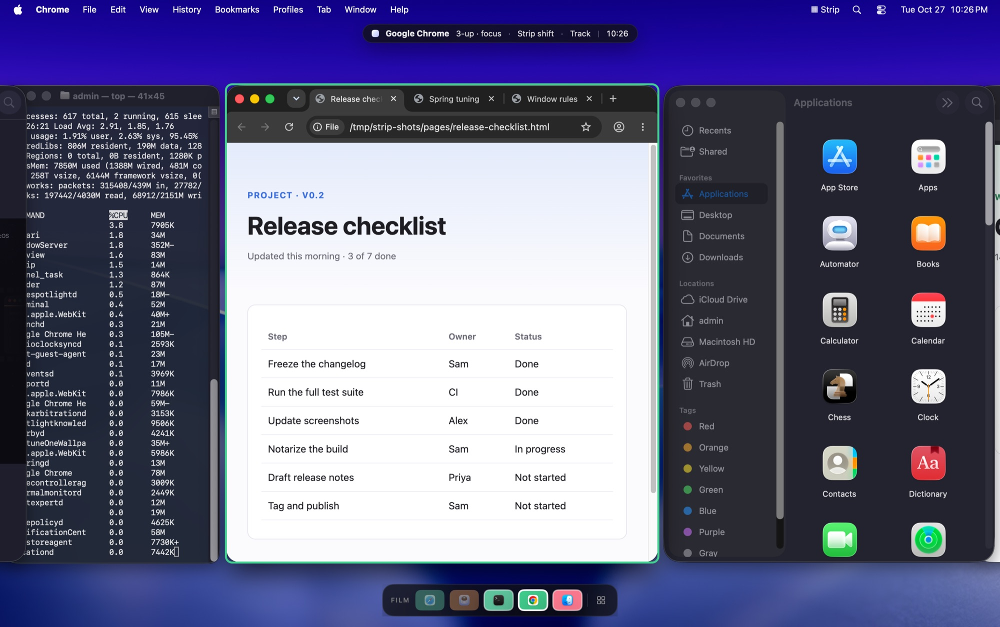
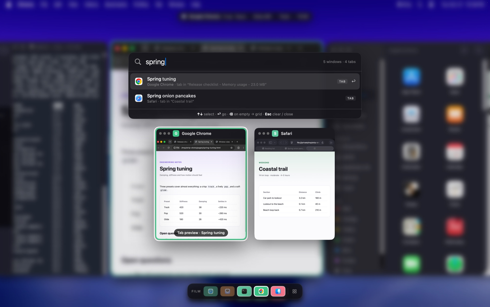

# Strip

<p align="center">
  
</p>

Strip is an experimental macOS window manager that arranges application windows on a horizontal
"film strip": the focused window stays centered while its neighbors flow past it.

**Website: [shidil.github.io/strip](https://shidil.github.io/strip/)**, with an animated
walkthrough of the idea.

> [!WARNING]
> Strip is an early, source-first project for developers and testers. There are no supported public
> binary releases yet. It can move and resize other applications' windows.

```text
parked  ←  [ window ] [ window ] [ FOCUSED ] [ window ] [ window ]  →  parked
```

Strip is built with Swift and AppKit. It uses macOS Accessibility for window control and does not
require disabling System Integrity Protection or installing a scripting addition.



## What It Does

- **A fixed center slot.** Roll the film with <kbd>⌃⌥H</kbd> / <kbd>⌃⌥L</kbd> and the next window
  slides into the center; your eyes stay put. Choose one, two or three slots with
  <kbd>⌃⌥1</kbd>–<kbd>⌃⌥3</kbd>.
- **Pinning.** Pin a slot with <kbd>⌃⌥P</kbd> to keep a reference window in place while the
  others roll past it.
- **Tiles as you work.** New windows open next to the focused one; closing the centered window
  hands the center to its neighbor. Dialogs, palettes and small windows float.
- **Overview** (<kbd>⌃⌥Space</kbd>). Live thumbnails of every window on the film, navigable with
  the arrow keys or `hjkl`.
- **Window and tab search** (<kbd>⌃⌥F</kbd>). Type to find any window, or any tab in Firefox,
  Safari, Chrome, Terminal or Finder. Arrowing onto a browser tab previews it in its card.
- **Film rail and focus ring.** A minimap of app icons with hover previews, dockable to any screen
  edge, and a colored ring around the focused window.
- **Respects your hands.** Strip pauses while you drag. A moved window springs back to its slot; a
  resized main window keeps its new size and the layout reflows around it.
- **Fits stubborn apps.** Strip learns each window's minimum and maximum size from what the app
  allows and sizes slots around those limits.
- **Escape hatch.** <kbd>⌃⌥0</kbd> puts every window back on screen and pauses Strip. Quitting
  never strands a window off-screen.



## Keyboard

Every shortcut is behind <kbd>⌃⌥</kbd> (Control + Option). <kbd>⌃⌥/</kbd> shows them all in the app.

| Keys | Action |
|---|---|
| <kbd>⌃⌥H</kbd> / <kbd>⌃⌥L</kbd> | Roll the film to the previous / next window |
| <kbd>⌃⌥J</kbd> / <kbd>⌃⌥K</kbd>, <kbd>⌃⌥Tab</kbd> | Move focus between slots |
| <kbd>⌃⌥⇧H</kbd> / <kbd>⌃⌥⇧L</kbd> | Swap the focused window with its neighbor |
| <kbd>⌃⌥1</kbd> <kbd>⌃⌥2</kbd> <kbd>⌃⌥3</kbd> | Monocle, two-up, three-up |
| <kbd>⌃⌥P</kbd> | Pin or unpin the focused slot |
| <kbd>⌃⌥E</kbd> | Toggle focus emphasis / equal widths |
| <kbd>⌃⌥=</kbd> / <kbd>⌃⌥-</kbd> | Widen / narrow the focused window |
| <kbd>⌃⌥↑</kbd> / <kbd>⌃⌥↓</kbd> | Make windows taller / shorter |
| <kbd>⌃⌥[</kbd> / <kbd>⌃⌥]</kbd> | Tighten / loosen gaps and padding |
| <kbd>⌃⌥T</kbd> | Cycle the motion style: Track, Pop, Glide |
| <kbd>⌃⌥Space</kbd> | Overview |
| <kbd>⌃⌥F</kbd> | Search windows and tabs (or <kbd>/</kbd> inside the Overview) |
| <kbd>⌃⌥0</kbd> | Release all windows / resume |
| <kbd>⌃⌥/</kbd> | Show every shortcut |

Strip's menu bar item offers the main commands, plus layout, minimap position and focus-ring options.

## Status and Scope

- **Status:** experimental alpha / daily-driver spike, not a supported product.
- **Tested platform:** macOS 14 and newer, primarily on a single ultrawide display.
- **Architecture:** menu-bar accessory app with a pure, unit-tested layout engine.
- **Distribution:** source builds only until Developer ID signing and notarized releases are ready.
- **App Store:** not eligible while it uses the private `_AXUIElementGetWindow` identity bridge.
- **Next:** workspaces (several independent strips), then launch at login, a config file for
  hotkeys and per-app rules, and vertical columns inside each slot.

Multi-display behavior, separate Spaces, polished installation, and stable binary releases remain
incomplete. See [PLAN.md](PLAN.md) and [BUGS.md](BUGS.md) for current status.

## Requirements

- macOS 14 or newer
- Xcode 16 command-line tools
- Accessibility permission for moving, resizing, observing, and focusing windows
- Screen Recording permission only for Overview thumbnails

## Build and Run

```bash
make test
make bundle
make open
```

Use `make open` for real testing. Launching the inner executable from a terminal does not receive
the same Accessibility trust because macOS TCC attributes that execution differently.

`make setup-signing` is an optional **developer-only** convenience. It creates a local self-signed
identity named `Strip Dev` so repeated development builds retain a stable TCC identity. It is not an
installation method and must never produce public binaries. See
[docs/DEVELOPMENT_SIGNING.md](docs/DEVELOPMENT_SIGNING.md).

## Permissions and Privacy

| Permission | Why Strip uses it | When requested |
|---|---|---|
| Accessibility | Enumerate, focus, move, and resize windows; receive global hotkeys | At first launch |
| Screen Recording | Capture still in-memory thumbnails for Overview | When Overview first requests thumbnails |

Strip currently contains no networking, telemetry, analytics, crash-upload, or update-checking
code. Window data and thumbnails remain local. Thumbnails are held in memory and are not written to
disk by Strip. `_AXUIElementGetWindow` is used only for stable identity; movement and resizing use
public Accessibility APIs.

Read [PRIVACY.md](PRIVACY.md) for the complete data model, compatibility warning, and revocation
steps.

## Uninstall

1. Quit Strip from its menu-bar menu and delete `Strip.app`.
2. Remove Strip from **System Settings → Privacy & Security → Accessibility**.
3. Remove Strip from **Screen & System Audio Recording** in the same settings area.
4. Contributors who ran `make setup-signing` may delete `Strip Dev` from the login keychain.

If macOS retains stale records:

```bash
tccutil reset Accessibility io.github.shidil.strip
tccutil reset ScreenCapture io.github.shidil.strip
```

## Known Limitations

- The private identity symbol can change or disappear in a future macOS release.
- Mac App Store distribution is not supported.
- Terminal applications resize in character-cell increments and may visibly step.
- Applications can impose minimum or fixed window sizes that differ from requested layouts.
- Multi-display and Spaces behavior is deliberately limited.
- Privacy grants are tied to bundle identity and code signing.

## Development

- [CONTRIBUTING.md](CONTRIBUTING.md) — setup, tests, style, and performance rules
- [docs/README.md](docs/README.md) — documentation map
- [ARCHITECTURE.md](ARCHITECTURE.md) — current architecture
- [TESTING.md](TESTING.md) — unit, live, and VM end-to-end testing
- [MEASURING.md](MEASURING.md) — required performance workflow
- [SECURITY.md](SECURITY.md) — vulnerability reporting

## License

Strip is available under the [MIT License](LICENSE). Vendored development tooling retains its own
license; see [THIRD_PARTY_NOTICES.md](THIRD_PARTY_NOTICES.md).
